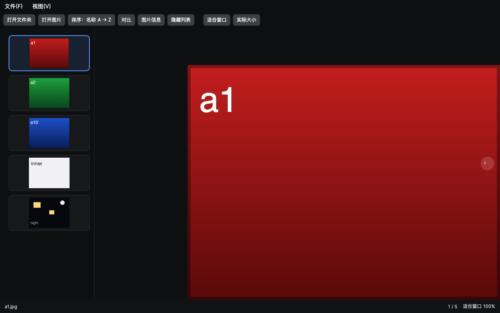

# PhotoLensWin

[PhotoLens](https://gitee.com/Finn-Wangfei/photolens)（macOS 版）的 Windows 移植：一个极简、快速的本地照片查看器，采用 **C# + Avalonia UI 11** 构建，操作逻辑、功能与 UI 交互尽量与 macOS 原版保持一致。



> 界面预览由开发机（macOS + Avalonia 11）渲染；Windows 下的字体与边框细节可能略有差异。

## 功能

- **文件夹/文件载入**：拖入文件夹或图片、菜单打开、命令行参数启动；递归收集子目录图片，跳过隐藏文件
- **胶片缩略图栏**（左侧）：异步加载缩略图、点击切换、选中高亮；按下位移 ≤4px 判定为点击，超过阈值进入拖拽
- **六种排序**（切换后保持当前图片位置）：名称 A→Z / Z→A（自然排序，`a2` 排在 `a10` 前）、修改时间 新→旧 / 旧→新、文件大小 大→小 / 小→大；同值时按文件名稳定兜底
- **缩放与平移**：滚轮 / Ctrl+滚轮以光标为锚缩放、放大后拖动平移、触屏捏合、双击在「适合窗口 / 100%」间切换；滚轮行为可在「视图 → 鼠标滚轮」改为切换图片
- **主题**：深色 / 浅色 / 跟随系统
- **对比模式**：主图与对比图左右分栏；从胶片栏拖拽卡片到右侧替换对比图；主图与对比图互斥；外部拖入的图不进列表
- **拖放高亮**：拖入图片/文件夹时画布出现蓝色描边提示
- **画质评分**（信息面板，按规则计算）：0.30 锐度 + 0.20 曝光 + 0.20 对比 + 0.18 分辨率 + 0.12 色彩；夜景图不因整体偏暗而扣曝光分
- **图片信息**（`I`）：像素尺寸、文件大小与格式、EXIF 拍摄参数、修改时间、路径
- **旋转**（`R` / `Ctrl+R`）：顺时针 90°，仅显示期生效
- **右键菜单**：复制图像 / 复制文件 / 复制文件路径 / 打开文件所在的位置 / 打开方式 / 属性 / 另存为 JPEG / 另存为 PNG
- **设置持久化**：上次文件夹、排序规则、列表显隐、主题（含跟随系统）、滚轮行为记忆在 `%APPDATA%/PhotoLensWin/settings.json`

## 支持的格式

`jpg · jpeg · jpe · jfif · png · tif · tiff · gif · bmp · webp · ico`

> 与 macOS 版的差异：**不含 HEIC/HEIF/AVIF**。Windows 的 Skia 解码栈默认不支持这些容器；如需支持需引入额外解码器。

## 下载与运行（Windows）

1. 打开 [发行版页面](https://gitee.com/Finn-Wangfei/photolens-win/releases)，下载 `PhotoLensWin-1.0-win-x64.zip`
2. 解压到任意目录，双击 `PhotoLensWin.App.exe`
3. 首次运行若出现「Windows 已保护你的电脑」，点「更多信息 → 仍要运行」（程序未做代码签名）

该包为 **win-x64 自包含单文件**，目标机无需安装 .NET。ARM64 设备（如 Surface Pro X）请按下方说明自行构建 `win-arm64` 版本。

## 从源码构建

### 依赖

- .NET SDK 7.0+（`dotnet --version` 确认）
- 无其他本机依赖；Avalonia 为纯托管渲染

### 一键构建（Windows PowerShell）

```powershell
powershell -ExecutionPolicy Bypass -File build.ps1
# 产物：dist\PhotoLensWin-1.0-win-x64.zip
```

### 手动构建 / 测试 / 运行

```bash
dotnet build                       # 0 警告 0 错误
dotnet test                        # 71 项单元测试（Core 逻辑：排序/评分/方向矩阵/目录/设置）
dotnet run --project src/PhotoLensWin.App -- [文件夹或图片路径...]
```

### 发布 Windows 单文件

在任意平台交叉编译（macOS/Linux 亦可）：

```bash
dotnet publish src/PhotoLensWin.App -c Release -r win-x64 --self-contained true \
  -p:PublishSingleFile=true -p:IncludeNativeLibrariesForSelfExtract=true \
  -o dist/win-x64
# 产物：dist/win-x64/PhotoLensWin.App.exe
```

- `--self-contained false` 可得到依赖框架的小体积版本（目标机需装 .NET 9 Desktop Runtime）
- 若需 win-arm64，将 RID 换为 `win-arm64`

### 自验快照模式（开发用）

```bash
# 加载文件夹、渲染整窗为 PNG 后自动退出
PHOTOLENS_SNAPSHOT=/tmp/out.png PHOTOLENS_SNAPSHOT_FOLDER=/tmp/photolens_test dotnet run --project src/PhotoLensWin.App
PHOTOLENS_SNAPSHOT_INFO=1    # 截图前展开信息面板
PHOTOLENS_SNAPSHOT_COMPARE=1 # 截图前进入对比模式
PHOTOLENS_SNAPSHOT_BROWSE=1  # 截图前逐张切换，覆盖缓存淘汰路径
```

## 快捷键

| 键 | 功能 |
| --- | --- |
| `←` / `→` | 上一张 / 下一张 |
| `Space` | 适合窗口 ↔ 100% 切换 |
| `9` / `F` | 适合窗口（与 Mac 版一致，`F` 不是全屏） |
| `0` / `1` | 实际大小 |
| `+` / `-` | 放大 / 缩小 |
| `[` / `]`（或 PageUp / PageDown） | 上一张 / 下一张 |
| `L` | 显示/隐藏胶片栏 |
| `I` | 图片信息面板 |
| `Z`（按住，无修饰键） | 放大镜 |
| `R` / `Ctrl+R` | 顺时针旋转（`Ctrl+R` 与 Windows 照片一致） |
| `Delete` | 移到回收站（不弹系统确认框） |
| `Home` / `End` | 第一张 / 最后一张 |
| `F5` | 开始 / 停止幻灯片 |
| `F11` | 全屏（`Esc` 退出） |
| `Ctrl+O` / `Ctrl+Shift+O` | 打开文件夹 / 打开图片 |

鼠标 / 触控：

| 操作 | 功能 |
| --- | --- |
| 滚轮 / Ctrl+滚轮 | 以光标为锚缩放 |
| 拖动 | 放大后平移 |
| 双击 | 适合窗口 ↔ 100% |
| 触屏捏合 | 缩放 |
| 胶片栏卡片拖拽 | 拖到右侧对比区设置对比图；按下位移 ≤4px 判定为点击 |

## 工程结构

```
PhotoLensWin.sln
├── src/PhotoLensWin.Core      # 纯逻辑：自然排序、六种排序规则、目录收集、画质评分、EXIF 方向矩阵、视图变换数学、设置
├── src/PhotoLensWin.App       # Avalonia UI：主窗口、胶片栏、图像查看器、缩略图缓存、拖放
└── tests/PhotoLensWin.Tests   # 71 项单元测试（xunit）
```

## 已验证与未验证

已在本机（macOS + Avalonia 11.3.2）实测核验（单元测试 + 整窗快照）：

- 自然排序 `a1 < a2 < a10`、六种排序规则与稳定兜底（71 项测试全部通过）
- 画质评分公式与夜景曝光豁免、评分失败回退「不可用」
- EXIF 方向 1–8 的四角映射与宽高互换（含方向 7 回归）
- 文件与其父目录重复拖入的去重
- 主界面布局、胶片缩略图加载与选中、信息面板、对比模式（4 张快照核验）
- 逐张浏览 5 张图（缓存容量 3）时的淘汰与释放路径，无崩溃

以下项依赖 Windows 真机环境，**未在开发机上验证**，请在 Windows 上按清单抽验：

- Windows 资源管理器向窗口拖放文件/文件夹
- 复制图像/文件到 Windows 剪贴板后粘贴（剪贴板延迟渲染）
- 真实滚轮/触屏板的 Ctrl+滚轮缩放手感与触屏捏合
- 拖动过程中 Alt-Tab / 系统抢占指针后的平移状态复位
- 放大镜（按住 `Z`）的视觉对齐
- 「打开文件所在位置」调起 `explorer.exe /select`
- 含 EXIF 方向标签的实拍照片显示方向
- win-x64 单文件产物的启动、字体渲染（含中文回退字体）与高 DPI 表现
- 键盘快速连续切换时的对比图竞态

## 已知限制

- GIF/WebP 只显示首帧（与 macOS 版一致）
- 旋转仅显示期生效，不写回文件
- 对比模式下滚轮缩放作用于主图（对比图固定适合窗口）
- 胶片栏全量创建缩略图控件、未做虚拟化；超大目录（数千张）首次载入会较慢
- 缩略图缓存淘汰依赖 GC 释放（避免释放正在显示的位图）

## 更新记录

见 [CHANGELOG.md](CHANGELOG.md)。

## 许可

[MIT License](LICENSE)
